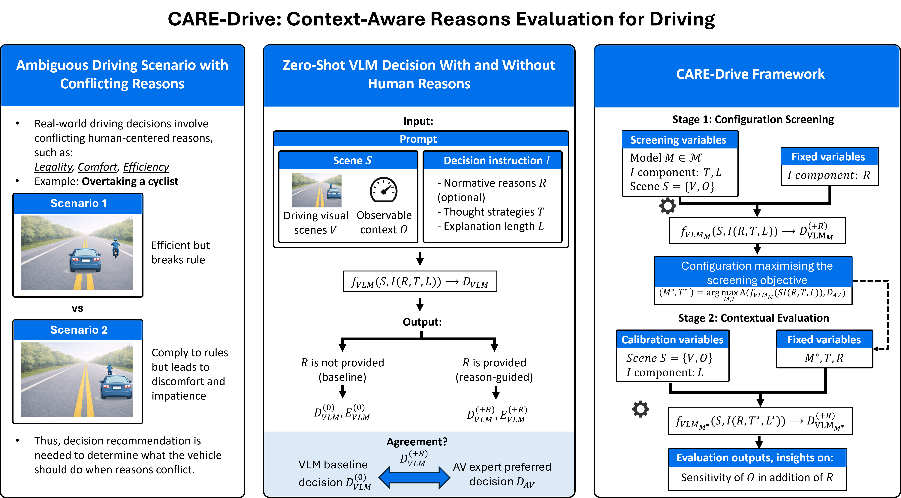

# CARE-Drive

**A Method for Evaluating Reason-Responsiveness of Vision–Language Models in Automated Driving**

Lucas Elbert Suryana, Farah Bierenga, Sanne van Buuren, Pepijn Kooij, Elsefien Tulleners, Federico Scari, Simeon Craig Calvert, Bart van Arem, and Arkady Zgonnikov

**Paper:** [arXiv:2602.15645](https://arxiv.org/abs/2602.15645) · Under review at *Transportation Research Part C: Emerging Technologies*

## Overview

Can a vision–language model (VLM) make driving decisions that respond to human-relevant reasons, rather than simply produce plausible explanations after choosing an action?

**CARE-Drive** (Context-Aware Reasons Evaluation for Driving) is a method for examining this question through observable model decisions. It compares baseline and reason-augmented prompting and varies driving context—such as the safety margin to oncoming traffic, nearby vehicles, and passenger urgency—to investigate when a model changes its decision. This is a behavioural evaluation; it does not establish how the model reasons internally.

We demonstrate CARE-Drive using a cyclist-overtaking scenario in which an automated vehicle must balance traffic-rule compliance with safety, comfort, and efficiency.



*Overview of the CARE-Drive method, including configuration screening (Stage 1) and contextual evaluation (Stage 2).*

## Evaluation procedure

CARE-Drive consists of two stages:

1. **Exploratory configuration screening (Stage 1).** We compare model and prompting configurations under fixed conditions, considering output consistency, recognition of the legal conflict, and agreement with an expert-reference decision. The initial screen contains **12 configurations**: four prompt configurations (Role-only, Role + human reasons, Role + human reasons + CoT, and Role + human reasons + ToT) across three GPT-4.1 models, with 30 runs per configuration. The retained configuration is **GPT-4.1 + Tree-of-Thought (ToT)**.
2. **Contextual evaluation (Stage 2).** With the selected configuration fixed, we vary time-to-collision with oncoming traffic, the presence of a vehicle behind, passenger urgency, following time, and explanation length. The main factorial experiment contains **120 conditions × 30 generations = 3,600 responses**. We also evaluate GPT-4.1 + Chain-of-Thought (CoT) as a reasoning-strategy comparison.

Additional experiments examine the contribution of individual prompt components, compare decisions with **Qwen3-VL-8B-Instruct**, and apply the method to a separate speed-offset task. A CARLA proof-of-concept is reported in the paper; its simulation code is not included here.

For the full experimental design, model settings, prompts and links between manuscript outputs and repository files, see [Experiment documentation](docs/experiments.md).

## Main findings

- **Context matters for GPT-4.1 + ToT.** Overtaking decisions vary with driving conditions, especially the available time-to-collision margin. Responses also differ by reasoning strategy and explanation-length instruction.
- **The complete prompt matters.** In the matched prompt-component analysis, overtaking was observed only with the complete CARE-Drive prompt, and only at the higher tested TTC. The human-reasons list alone did not reproduce that result.
- **Qwen produced no overtaking decisions** in 400 generations across the tested conditions. This demonstrates a difference in observed action selection relative to GPT-4.1; it does not establish whether Qwen is responsive to human reasons in other conditions or whether the evaluation generalises across model families. One Qwen response could not be parsed into a decision.
- **The speed-offset experiment is preliminary.** The complete prompt produced positive *mean* offsets in the four tested traffic contexts, whereas the baseline mean remained zero. This was one scene and one model configuration, not a broad test across driving tasks.

These results describe the tested model configurations and scenarios, not a general ranking of VLM driving performance or safety.

## Reproduce the results

The repository includes archived model outputs and scripts to recompute the paper's results **without calling an API or using a GPU**. Stage 2, the prompt ablation and speed-offset results can be analysed from saved per-generation records. **Stage 1 (Tables 4–5) is different:** only a compiled summary workbook is available, so its reported counts can be checked against that record but not reconstructed from individual model responses.

### Quick start

Use Python 3.10 or newer. The analysis environment was tested with Python 3.13.12 on Linux using the pinned packages.

```bash
git clone https://github.com/lucassuryana/CARE-Drive.git
cd CARE-Drive
python -m venv .venv
source .venv/bin/activate        # Windows: .venv\Scripts\activate
pip install -r requirements.txt

python -m reproduce.reproduce_all --stats
pytest
```

The first command recomputes available results and writes a comparison report to `reproduce/output/verification.md`. The tests check key results and the integrity of archived input files. Results are labelled `MATCH`, `RECORD_ONLY`, `NOT_VERIFIABLE`, or `MISMATCH`; **a completed run does not mean every manuscript value matches**. See [Reproducibility report](docs/reproducibility_report.md) for known discrepancies and their interpretation.

For a faster test run without the statistical bootstrap:

```bash
pytest -m "not slow"
```

If an unrelated installed pytest plugin causes collection errors, try `PYTEST_DISABLE_PLUGIN_AUTOLOAD=1 pytest`.

### Figures and tables

Run the commands below from the repository root unless stated otherwise.

| Manuscript output | Source / reproduction |
| --- | --- |
| Tables 4–5: Stage 1 screening | `reproduce/output/table4_stage1_record.csv`, `table5_stage1_record.csv` — aggregate records only |
| Fig. 5: Stage 2 decision rates | `python figures/figure_05/care_drive_stage2_figures.py` |
| Tables 6–8: statistical analysis | `python tables/table_06-08/care_drive_stage2_analysis.py` |
| Fig. 6: GPT-4.1 prompt ablation | `python figures/figure_06/make_figure_06.py` |
| Table 9: GPT-4.1 / Qwen comparison | `reproduce/output/table9_gpt.csv`, `table9_qwen.csv` |
| Fig. A.8: speed offsets | `figures/figure_A8/GPT4_speed_offset_figure.ipynb` |
| Table A.12: speed-offset summary | `reproduce/output/tableA12_gpt.csv` |

To create the derived CSVs, run the quick-start reproduction command first. For the speed-offset figure, execute its notebook from `figures/figure_A8/` after installing Jupyter/nbconvert.

## Repository contents

```text
CARE-Drive/
├── Images/                   # Visual inputs used in the experiments
├── figures/                  # Data, scripts and notebooks for figures
│   ├── figure_05/            # Stage 2: ToT and CoT
│   ├── figure_06/            # Prompt-component ablation
│   └── figure_A8/            # Speed-offset evaluation
├── tables/                   # Screening, statistics and Qwen experiments
│   ├── table_04/             # Stage 1, Step 1
│   ├── table_05/             # Stage 1, Step 2
│   ├── table_06-08/          # Logistic regression and related analyses
│   ├── table_09/             # Qwen prompt ablation
│   └── table_A12/            # Exploratory Qwen speed-offset experiment
├── reproduce/                # Recompute and compare archived results
├── tests/                    # Validation tests
├── docs/                     # Experimental protocol and audit report
├── requirements.txt          # Analysis dependencies
├── requirements-experiments.txt
└── final_results_table_3_4_5_6.xlsx  # Archived Stage 1 summaries
```

The original generation prompts remain in the experiment scripts. Some historical scripts and exploratory outputs are preserved for completeness; not every file corresponds to a result in the manuscript. See [docs/experiments.md](docs/experiments.md) for that distinction.

## Rerun the VLM experiments

Rerunning a model experiment is **separate** from reproducing the analysis of the archived outputs. It requires API access for GPT-4.1 or suitable local hardware for Qwen, and may incur costs.

```bash
pip install -r requirements-experiments.txt
export OPENAI_API_KEY="your-key"   # for OpenAI experiments
```

The generation scripts are located alongside their outputs in `figures/` and `tables/`. See [docs/experiments.md](docs/experiments.md) for the exact commands, settings and expected run counts. New runs are directed to separate output locations so the original records are not overwritten.

**Please note:** model versions and inference environments can change, and the original generations were not all seeded. New runs may therefore produce different decisions even when the experimental design is the same. Some historical configurations, including `gpt-4.1-nano`, may no longer be available.

## Reproducibility notes

The [audit report](docs/reproducibility_report.md) documents the results checked against the paper and the remaining differences. In particular:

- **Stage 1:** individual generations are unavailable; only the archived aggregate workbook can be checked. The Role-only baseline also lacks its original generation script.
- **Prompt ablation:** the paper's GPT-4.1 Condition E values come from the matched subset of the Stage 2 ToT data, not the separate Condition E run in the ablation workbook. Conditions A–D and E also used somewhat different API paths and prompt wording.
- **Qwen:** the 400 generations include one response that was not parsed into a binary decision; the handling of this case is documented in the analysis.
- **CARLA:** the demonstration video is available at [4TU.ResearchData](https://doi.org/10.4121/ed2fd9ef-3814-4beb-a888-75f267974297), but its source code is not part of this repository.

These limitations should be considered when interpreting or extending the experiments.

## Citation

If CARE-Drive is useful in your work, please cite the paper:

```bibtex
@article{suryana2026caredrive,
  title={CARE-Drive: A Method for Evaluating Reason-Responsiveness of Vision--Language Models in Automated Driving},
  author={Suryana, Lucas Elbert and Bierenga, Farah and van Buuren, Sanne and Kooij, Pepijn and Tulleners, Elsefien and Scari, Federico and Calvert, Simeon Craig and van Arem, Bart and Zgonnikov, Arkady},
  journal={arXiv preprint arXiv:2602.15645},
  year={2026},
  note={Under review at Transportation Research Part C: Emerging Technologies}
}
```

## License

The original source code is intended to be released under the **MIT License**; see `LICENSE` once the licence file has been added and the relevant rights have been confirmed. This does **not** automatically apply to archived model outputs, generated figures or third-party images. Please check their rights and the accompanying documentation before reuse.
